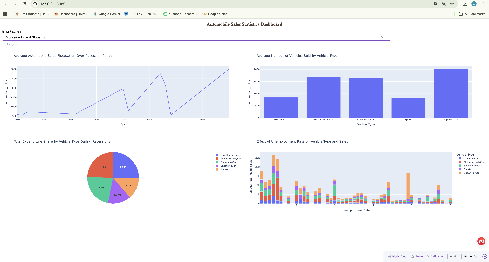
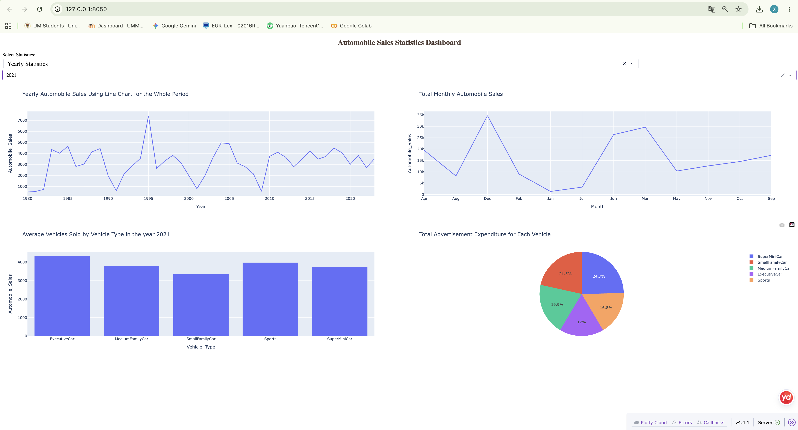

# Automobile Sales During Recessions vs. Non-Recessions

**An exploratory data-analysis and interactive-dashboard project built for CISC7204 – Data Science and Data Visualization (University of Macau).**

This repository investigates how the sales volume of a fictional automobile manufacturer (**XYZAutomotives**) behaves across six historical recession windows compared with normal (non-recession) periods, and which macro-economic and marketing factors move together with those sales.

---

## Table of Contents

1. [Research Question](#research-question)
2. [Repository Contents](#repository-contents)
3. [Dataset and Usage Rights](#dataset-and-usage-rights)
4. [Methodology and Tools](#methodology-and-tools)
5. [Key Findings](#key-findings)
6. [Limitations](#limitations)
7. [Getting Started](#getting-started)
8. [Reproducing the Analysis](#reproducing-the-analysis)
9. [Author](#author)
10. [Coursework Archive](#coursework-archive)

---

## Research Question

> **How do automobile sales change during economic recessions compared with non-recession periods, and which factors — advertising expenditure, GDP, unemployment, consumer confidence, vehicle price, seasonality, and vehicle type — help explain those changes?**

The analysis breaks this question into sub-questions that are answered both in the notebook and in the interactive dashboard:

- How does average annual sales volume fluctuate over time, and where do the recessions fall?
- Does advertising expenditure move together with sales during normal periods?
- How large is the gap in average sales between recession and non-recession periods?
- Which vehicle segments gain or lose the most during downturns?
- How do GDP, unemployment, consumer confidence, price, and seasonality relate to sales?

---

## Repository Contents

| File | Description |
| --- | --- |
| `01_automobile_sales_eda.ipynb` | The main analysis notebook: data loading, cleaning, and 11+ static visualisations built with Matplotlib, Seaborn and Folium. |
| `02_sales_dashboard.py` | A standalone **Dash** application that serves an interactive "Automobile Sales Statistics Dashboard" with Yearly and Recession report modes. |
| `recession_report.png` | Screenshot of the dashboard in **Recession Period Statistics** mode (four linked charts). |
| `yearly_report.png` | Screenshot of the dashboard in **Yearly Statistics** mode for the year 2021 (four linked charts). |
| `requirements.txt` | All Python libraries required to run both the notebook and the dashboard. |

---

## Dataset and Usage Rights

- **Source:** the `automobile-sales.csv` teaching dataset distributed with IBM's *Data Visualization with Python* course (DV0101EN) on the IBM Skills Network. The notebook and dashboard fetch it at runtime from IBM's public course storage (`cf-courses-data.s3.us.cloud-object-storage...`), so the raw data is **not redistributed** in this repository.
- **Scope:** end-of-month observations from **1980 to 2023**, describing the sales of the fictitious company **XYZAutomotives**. Each row records `Date`, `Recession` (1 = recession, 0 = normal), `Automobile_Sales`, `GDP`, `Unemployment_Rate`, `Consumer_Confidence`, `Seasonality_Weight`, `Price`, `Advertising_Expenditure`, `Vehicle_Type`, `Competition`, `Month`, `Year`, plus a `City` field used for mapping.
- **Recession windows flagged in the data:** 1980 · 1981–1982 · 1991 · 2000–2001 · late 2007 – mid 2009 · February–April 2020 (COVID-19).
- **Usage:** the dataset is used **strictly for academic and educational demonstration** in this coursework portfolio. It is the property of IBM Skills Network and is subject to its educational terms; it must not be used commercially or represented as real market data. The figures are modelled/synthetic and are intended to illustrate analytical relationships, not to report actual industry sales.

---

## Methodology and Tools

**Workflow**

1. **Ingest** – download the CSV and the US-states GeoJSON directly over HTTP with `requests`; read into a pandas `DataFrame`.
2. **Segment** – split the data into recession (`Recession == 1`) and non-recession (`Recession == 0`) subsets and aggregate by year, month, and vehicle type.
3. **Explore visually** – build a sequence of charts that isolate one factor at a time (time trend, advertising, GDP, seasonality, consumer confidence, price, unemployment, vehicle mix, geography).
4. **Communicate** – package the same analysis as an interactive Dash app so a user can switch between a whole-period yearly view and a recession-only view, and filter by year.

**Libraries**

| Layer | Tools |
| --- | --- |
| Data handling | `pandas`, `numpy` |
| Static visualisation | `matplotlib`, `seaborn`, `folium` (choropleth map) |
| Data acquisition | `requests` |
| Interactive dashboard | `dash`, `plotly` (`plotly.express`, `plotly.graph_objs`) |
| Notebook runtime | `jupyter` |

**Charts produced in the notebook:** yearly average-sales line chart with recession annotations; advertising-vs-sales dual line chart (non-recession); average sales bar chart (recession vs non-recession); vehicle-type grouped bar chart; GDP sub-plots; seasonality bubble scatter; consumer-confidence and price scatters; advertising-share pie charts; unemployment grouped bar chart; and a Folium choropleth of sales by city.

---

## Key Findings

### 1. Recession-period sales swing widely and trough around each downturn



In **Recession Period Statistics** mode the dashboard shows that average annual sales during recessions are far from flat: they range from roughly **500 units at the troughs (around 1990, 2000 and 2009)** to about **3,000 units at the peaks (around 2006 and 2020)**. Each trough lines up closely with a flagged recession window, which is the core evidence that sales contract when the economy turns down.

The same view shows a clear **shift toward cheaper segments**: during recessions the **SuperMiniCar** segment records the highest average volume (≈3,000 units), while **ExecutiveCar** and **Sports** cars sit at the bottom (≈850 units each). The advertising budget is spread fairly evenly across the five segments — roughly **14%–25%** each, with SuperMiniCar taking the single largest share (~25%) and ExecutiveCar the smallest (~14%) — i.e. the manufacturer does not dramatically re-weight spend by segment during downturns.

### 2. Long-run trend peaks mid-1990s; sales are strongly seasonal within a year



In **Yearly Statistics** mode (year 2021 selected) the whole-period line chart shows average sales rising to a peak of roughly **7,000 units around 1995**, then falling through the **1990–91, 2000–01 and 2009–10** dips before recovering. The monthly chart reveals a pronounced **seasonal cycle**: sales climb to a December peak of roughly **30,000 units** and bottom out in the first half of the year at around **7,000 units** — consistent with year-end promotions and new-model launches.

Interestingly, the vehicle mix in the 2021 recovery year looks different from the recession average: **ExecutiveCar leads average sales (~3,800 units)**, ahead of Sports and SuperMiniCar (≈3,000), which suggests that as confidence returns buyers trade back up to larger, more expensive models.

### 3. Advertising spend alone does not explain sales

The notebook's non-recession analysis shows that **sales are considerably more volatile than advertising expenditure**: the two series occasionally align but sales frequently spike on their own, and the correlation is inconsistent across time. This indicates that demand-side and macro factors — not marketing spend alone — drive the sales cycle.

### 4. Macro-economic conditions move with sales

Across the notebook charts, **GDP falls during recession windows**, and higher **unemployment** is associated with lower sales across vehicle types, while **consumer confidence** and **price** show the expected directional relationships (confidence up → sales up; price up → sales down). These relationships are descriptive and are explored chart-by-chart rather than through a formal regression model.

---

## Limitations

- **Synthetic teaching data.** The XYZAutomotives dataset is a modelled dataset created for an IBM course. The sales values are not real transactions, so the results illustrate *plausible relationships* rather than establish facts about the real automobile market.
- **Correlation is not causation.** The advertising-vs-sales, confidence-vs-sales and price-vs-sales relationships are shown descriptively. No controlled or regression design isolates a causal effect, and several factors (GDP, unemployment, confidence, price) are themselves correlated, so their individual contributions cannot be separated from these charts alone.
- **Coarse recession labelling.** `Recession` is a fixed binary flag over six historical windows. It does not capture the *severity* or *duration* of each downturn, so a deep recession and a mild one are treated identically.
- **Aggregation hides heterogeneity.** Data are aggregated by year/month/vehicle type; firm-level, model-level, and regional variation is lost, and the city-vs-state mismatch in the Folium choropleth means the geographic view should be read as illustrative only.
- **Single company, single market.** Conclusions come from one fictional US-market manufacturer and should not be generalised to other firms, countries, or product categories.

---

## Getting Started

**Prerequisites:** Python 3.10 or newer, Git, and an internet connection (the data and GeoJSON are downloaded at runtime).

```bash
# 1. Clone the repository
git clone https://github.com/wang-xiuting/data-science-project.git
cd data-science-project

# 2. Create and activate a virtual environment
python -m venv .venv
source .venv/bin/activate          # macOS / Linux
# .venv\Scripts\activate           # Windows (PowerShell / cmd)

# 3. Install dependencies
pip install -r requirements.txt
```

---

## Reproducing the Analysis

### Run the notebook (`01_automobile_sales_eda.ipynb`)

```bash
# Interactive
jupyter notebook 01_automobile_sales_eda.ipynb

# Non-interactive: execute all cells and save the outputs
jupyter nbconvert --to notebook --execute 01_automobile_sales_eda.ipynb \
    --output 01_automobile_sales_eda.executed.ipynb
```

Run the cells top-to-bottom. The notebook downloads `automobile-sales.csv` and `us-states.json`, then renders every chart inline.

### Run the dashboard (`02_sales_dashboard.py`)

```bash
python 02_sales_dashboard.py
```

Then open **http://127.0.0.1:8050** in a browser. Use the *Select Statistics* dropdown to switch between **Yearly Statistics** (choose a year to enable the year selector) and **Recession Period Statistics**. Each mode renders a 2×2 grid of linked Plotly charts.

> **Note on the Dash API:** the script calls `app.run(debug=True)`, which is the Dash 3.x entry point. If you are pinned to an older Dash 2.x release, replace it with `app.run_server(debug=True)`. Installing from `requirements.txt` (unpinned) pulls a current Dash version, so no change is normally required.

---

## Author

**WANG XIUTING**
Master's student in Data Science and Compliance, University of Macau
Course: CISC7204 – Data Science and Data Visualization

*Code in this repository is shared for academic portfolio purposes. The dataset remains the property of IBM Skills Network and is used under its educational terms.*

---

## Coursework Archive

This repository also keeps the supporting CISC7204 coursework. Each subfolder has its own `README.md` with a module-by-module breakdown.

| Folder | Contents |
| --- | --- |
| [`assignment-01/`](assignment-01/) | **Assignment 01 – Data Analysis with Python.** Modules 1–6: importing datasets, data wrangling, exploratory data analysis, model development, model evaluation and refinement, plus the final/practice projects and the preliminary project proposal. |
| [`assignment-02/`](assignment-02/) | **Assignment 02 – Data Visualization with Python.** Modules 01–05: Matplotlib / Seaborn chart types, geospatial maps, Plotly and Dash dashboards, the wildfire practice assignment, and the revised project proposal. |

Both folders contain the original submission files (notebooks, scripts, datasets, figures and proposals) with large screenshot folders, web-page caches and macOS metadata removed. The cleaned-up automobile-sales deliverables in the repository root originate from `assignment-02/Module 05/`.
